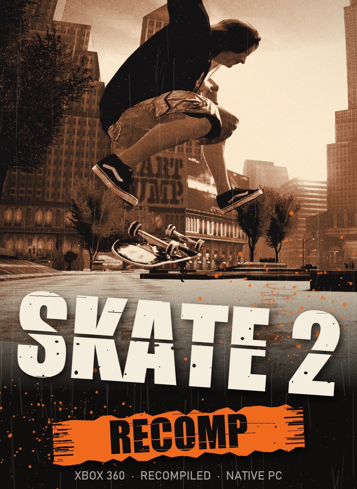
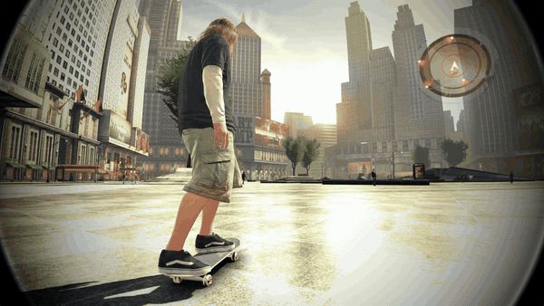
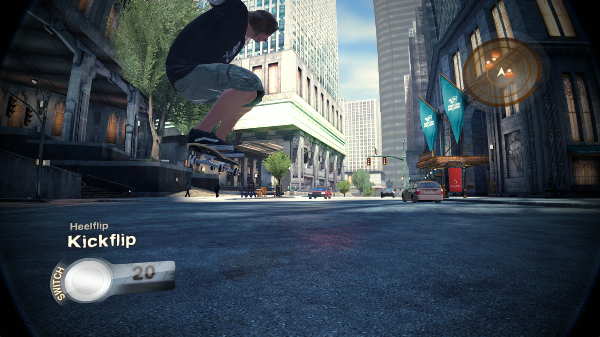
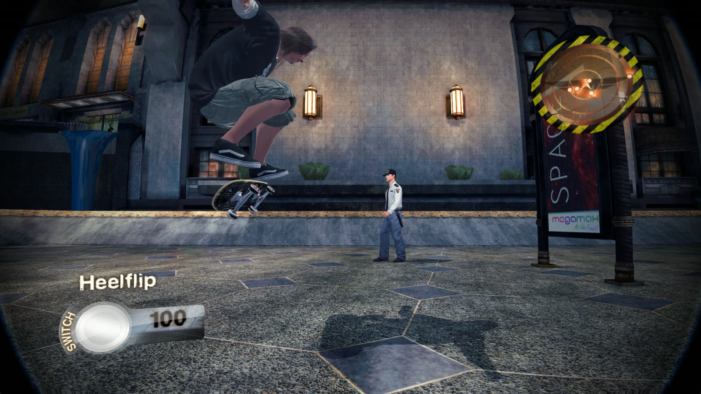
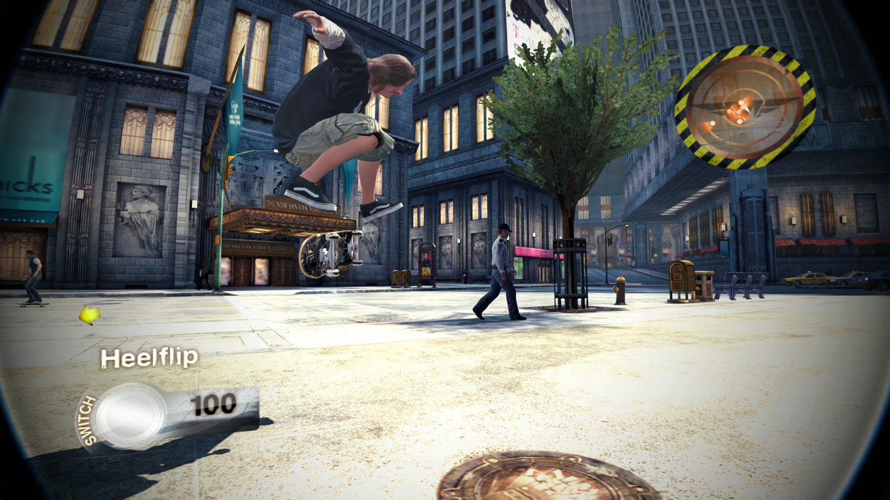
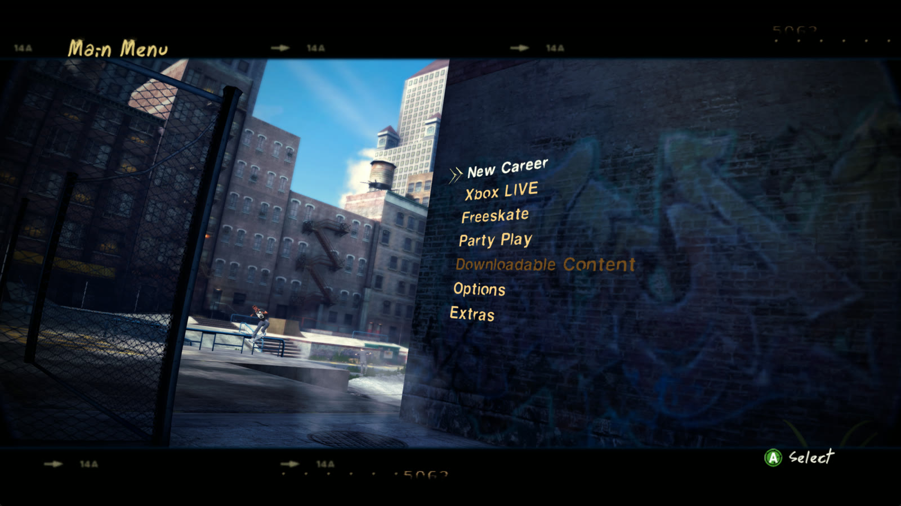
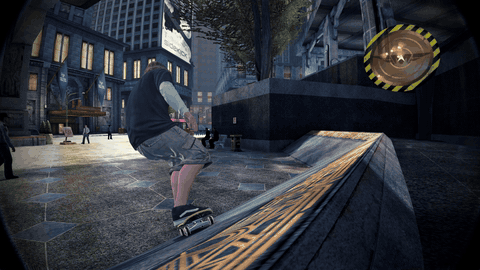
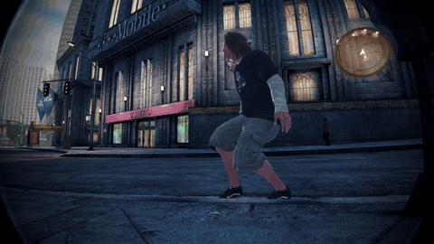
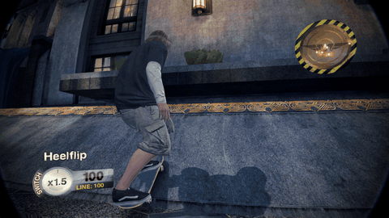
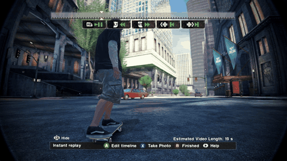

### Skate 2 for the Xbox 360, recompiled to run natively on PC. Pick your ISO, install with one click and skate San Vanelona at up to 4x the console's resolution.

 

Recorded on Windows 11 with 3x rendering (3456 × 1920) and 60 FPS, European Xbox 360 release. <b>No game files included</b>: you need your own copy of Skate 2.

## At a glance

| | | |
| :-- | :-- | :-- |
| 💿 **One-file setup** Choose your `.iso` (or extracted game folder) and an install folder; the setup does the rest. | 🖥️ **Up to 4x resolution** Render at 1x to 4x the console's internal picture. | 🎞️ **60 FPS and beyond** Original, 60 to 240 FPS or unlimited. |
| 🛹 **The whole city** Free Skate, the career and the replay editor run natively. | 🎮 **Controllers** Xbox-style controls; a USB DualSense works without DS4Windows. | 🚀 **Launcher window** Quality, FPS and a big **Play** button; works with a controller. |
| 🔄 **Updates keep your saves** A newer setup replaces only the program files. | 🐧 **Proton** No PowerShell or .NET needed; built to run on Steam Deck. | 🧩 **Same game code as upstream** Built on [skate2-recompile-pc](https://github.com/christianortel/skate2-recompile-pc). |

> [!NOTE]
> **Early days.** Free Skate, the start of the career and the replay editor work (the footage on this
> page is from Free Skate). The game code comes from upstream, which has been tested for about an hour
> of the career. **Steam Deck / Proton has not been tested on a device yet.** If something breaks,
> please [report it](#reporting-a-problem).

## In motion

<b>Flip tricks</b> on the plaza &nbsp;·&nbsp; <b>Heelflip into a frontside 50-50</b> on a curb

 

<b>Slams</b>, ragdoll and all &nbsp;·&nbsp; The <b>replay editor</b> from the pause menu

## Getting started

### Windows

1. Download **Skate2-PC-Setup-v0.2.1.exe** (or the `.zip` of it) from [Releases](https://github.com/ASarafanov/skate2recomp/releases/latest) and run it. The program is not code-signed, so Windows may show "Windows protected your PC". Click **More info**, then **Run anyway**.
2. Choose your Skate 2 `.iso` with **Browse...**, or drop it onto the window. An already extracted game folder (with `default.xex` and `data`) works too. Archives such as `.rar` must be extracted first.
3. Pick the install folder (default `C:\Games\Skate 2`) and press **Install**. The setup checks the disc before copying anything. If the install is interrupted, run it again on the same folder to continue.
4. Press **Play**. Later, start **Launch Skate 2.exe** in the install folder or from the Desktop / Start menu shortcut. It opens the launcher window: pick quality and FPS if you like, then **Play**.

### Steam Deck and Linux (Proton)

1. In Desktop Mode, add `Skate2-PC-Setup-v0.2.1.exe` to Steam as a non-Steam game, force a Proton version in **Properties → Compatibility**, and start it.
2. Select your ISO and keep the suggested `~/Games/Skate 2`. When the install finishes, the setup shows the Linux path of `Launch Skate 2.exe`.
3. Add that `Launch Skate 2.exe` to Steam the same way, force Proton, and play from Game Mode.

Under Proton the defaults are 1x quality and 60 FPS.

### Settings

| Where | What |
| :-- | :-- |
| The launcher window (**Launch Skate 2.exe**) | Rendering quality (1x–4x), frame rate, render path (ROV / RTV), windowed, then **Play**. Saved in `launcher.ini`. With a controller: d-pad to move and change, <kbd>A</kbd> to select, <kbd>Start</kbd> to play, <kbd>B</kbd> to quit. |
| <kbd>F4</kbd> in the game | PC settings: audio output, controls and more. Choose **Save to config** and restart. |
| Launch options | `--play` skips the launcher window. Also `--render-scale N`, `--frame-rate X`, `--windowed`, or any `--flag=value` of the game. |

Saves are in `userdata` inside the install folder. To update, run a newer setup on the same folder: it keeps `userdata`, `skate2.toml` and `launcher.ini`, and does not need the disc.

### Requirements

- Windows 10 or 11 x64 with a Direct3D 12 graphics card, or Linux / Steam Deck with Proton.
- About 7 GB free.
- The Xbox 360 release of Skate 2 with title ID `4541087F` and media ID `6ADB5821` (`default.xex` SHA-256 `116ba3ee37fcf0d8db60b7d47c971fdb6d3eb2a7a4d3cfc3611a06704a588ae5`). The setup tells you if your copy is a different release.
- A controller.

## Known limits

- Not code-signed, so SmartScreen and some antivirus programs may warn.
- Steam Deck / Proton has not been tested on a device yet.
- Install paths with non-Latin characters (for example Cyrillic) are refused, because the game cannot open them.
- Only one Xbox 360 release is supported (see above). The game code was compiled from it.
- Game-side limits are upstream's: see its [known issues](docs/KNOWN_ISSUES.md) and [display notes](docs/DISPLAY.md).

## Building

- **The setup** needs Visual Studio 2022 (or Build Tools) with C++ and Python 3. Run `setup\build.cmd`, then `python tools\package_setup.py`. The script packs upstream's prebuilt game (checked by SHA-256) and needs no game files. See [setup/README.md](setup/README.md).
- **The game itself** (recompiling `skate2.exe` from your own `default.xex`) follows upstream's [build guide](docs/BUILD.md).

## Reporting a problem

[Open an issue](https://github.com/ASarafanov/skate2recomp/issues) and include:

- the Windows version, or Steam Deck with the Proton version;
- your GPU;
- what you did;
- `launcher.log`, `setup.log` and the latest file from `logs` in the install folder.

Remove personal paths from logs, and don't upload game files or saves. Problems inside the game may belong [upstream](https://github.com/christianortel/skate2-recompile-pc/issues).

## Credits and license

- The recompiled game, its runtime patches and the game configuration are the work of [christianortel/skate2-recompile-pc](https://github.com/christianortel/skate2-recompile-pc).
- That project is built with the [ReXGlue SDK](https://github.com/rexglue/rexglue-sdk) and [Xenia](https://github.com/xenia-project/xenia); see its [credits](docs/HOW_IT_WORKS.md#credits).
- The setup and launcher in `setup/` were added in this fork.
- Project code is [MIT licensed](LICENSE). Dependencies keep their own licenses; see the [third-party notices](THIRD_PARTY_NOTICES.md).

This is an independent fan project, not affiliated with EA or its licensors. Skate 2 and its game content belong to their respective rights holders. The project license does not cover the original game, its assets or generated game-derived code.
